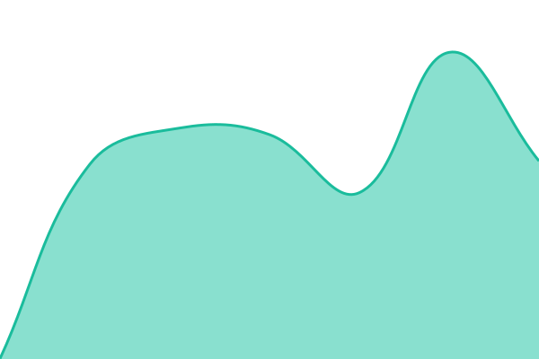
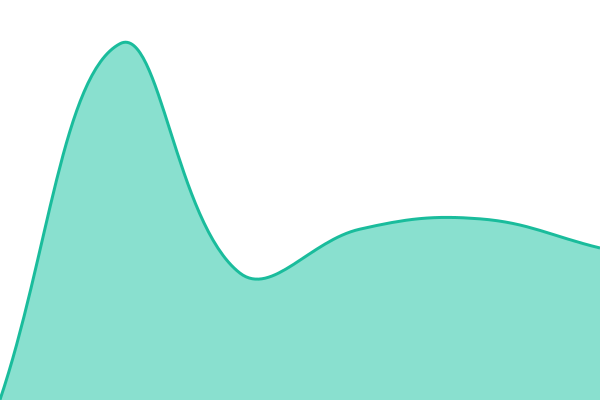
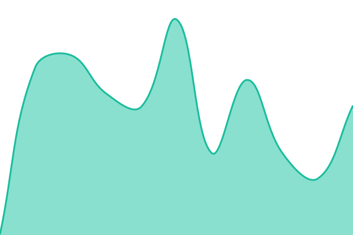
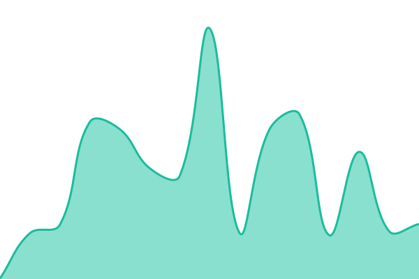
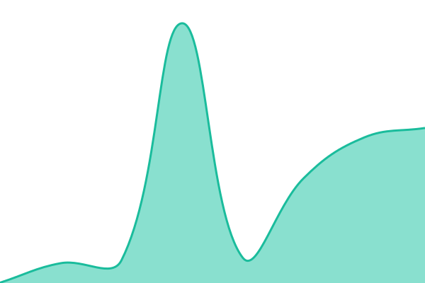

# [📈 Live Status](https://status.kreativ-anders.dev): <!--live status--> **🟩 All systems operational**

This repository contains the open-source uptime monitor and status page for [kreativ-anders](kreativ-anders.de), powered by [Upptime](https://github.com/upptime/upptime).

With [Upptime](https://upptime.js.org), you can get your own unlimited and free uptime monitor and status page, powered entirely by a GitHub repository. We use [Issues](https://github.com/kreativ-anders/upptime/issues) as incident reports, [Actions](https://github.com/kreativ-anders/upptime/actions) as uptime monitors, and [Pages](https://status.kreativ-anders.dev) for the status page.

<!--start: status pages-->
<!-- This summary is generated by Upptime (https://github.com/upptime/upptime) -->
<!-- Do not edit this manually, your changes will be overwritten -->
<!-- prettier-ignore -->
| URL | Status | History | Response Time | Uptime |
| --- | ------ | ------- | ------------- | ------ |
|  [kreativ-anders.de](https://kreativ-anders.de) | 🟩 Up | [kreativ-anders-de.yml](https://github.com/kreativ-anders/upptime/commits/HEAD/history/kreativ-anders-de.yml) | 

 625ms
     
 | 

<a href="https://status.kreativ-anders.dev/history/kreativ-anders-de">100.00%</a>
    

|  [bookmark.cards](https://bookmark.cards) | 🟩 Up | [bookmark-cards.yml](https://github.com/kreativ-anders/upptime/commits/HEAD/history/bookmark-cards.yml) | 

 674ms
     
 | 

<a href="https://status.kreativ-anders.dev/history/bookmark-cards">98.71%</a>
    

|  [News Reader](https://news-reader.app) | 🟩 Up | [news-reader.yml](https://github.com/kreativ-anders/upptime/commits/HEAD/history/news-reader.yml) | 

 683ms
     
 | 

<a href="https://status.kreativ-anders.dev/history/news-reader">100.00%</a>
    

|  [Sustainable Web Analyzer](https://swa.kreativ-anders.dev) | 🟩 Up | [sustainable-web-analyzer.yml](https://github.com/kreativ-anders/upptime/commits/HEAD/history/sustainable-web-analyzer.yml) | 

 566ms
     
 | 

<a href="https://status.kreativ-anders.dev/history/sustainable-web-analyzer">100.00%</a>
    

|  [Wharf](https://wharf.kreativ-anders.dev) | 🟩 Up | [wharf.yml](https://github.com/kreativ-anders/upptime/commits/HEAD/history/wharf.yml) | 

 182ms
     
 | 

<a href="https://status.kreativ-anders.dev/history/wharf">100.00%</a>
    

|  [FinanzGecko](https://finanzgecko.app) | 🟩 Up | [finanz-gecko.yml](https://github.com/kreativ-anders/upptime/commits/HEAD/history/finanz-gecko.yml) | 

 164ms
     
 | 

<a href="https://status.kreativ-anders.dev/history/finanz-gecko">100.00%</a>
    

|  [blowcookie.xyz](https://blowcookie.xyz) | 🟩 Up | [blowcookie-xyz.yml](https://github.com/kreativ-anders/upptime/commits/HEAD/history/blowcookie-xyz.yml) | 

 303ms
     
 | 

<a href="https://status.kreativ-anders.dev/history/blowcookie-xyz">100.00%</a>
    

|  [steinberg.agency](https://steinberg.agency) | 🟩 Up | [steinberg-agency.yml](https://github.com/kreativ-anders/upptime/commits/HEAD/history/steinberg-agency.yml) | 

 318ms
     
 | 

<a href="https://status.kreativ-anders.dev/history/steinberg-agency">100.00%</a>
    

<!--end: status pages-->

[**Visit our status website →**](https://status.kreativ-anders.dev)

## 📄 License

- Powered by: [Upptime](https://github.com/upptime/upptime)
- Code: [MIT](./LICENSE) © [Anand Chowdhary](https://anandchowdhary.com)
- Data in the `./history` directory: [Open Database License](https://opendatacommons.org/licenses/odbl/1-0/)
